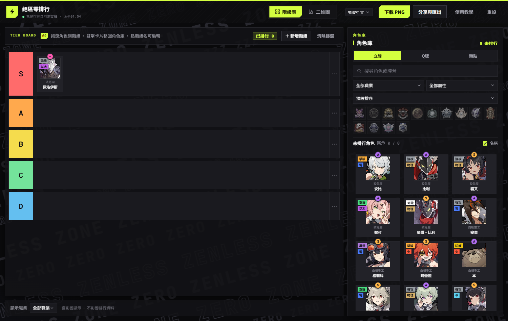
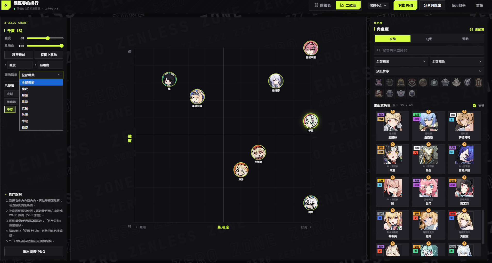

# ZZZ Tier List Maker

**Zenless Zone Zero tier list × 2-axis chart tool — works on desktop, mobile, and offline**

[繁體中文](../README.md) · [English](README.en.md) · [日本語](README.ja.md) · [한국어](README.ko.md)

---

## Introduction

A community tool for Zenless Zone Zero: build **tier lists** and **strength × ease-of-use 2-axis charts**. Pure vanilla JavaScript — no build step, no backend, all assets local. It works fully offline, even opened directly via `file://`.

Supports four languages (Traditional Chinese / English / 日本語 / 한국어); both UI strings and agent names switch instantly.

## Player's Guide

**Roster coverage**

- **63 agents**: 7 roles (Attack / Stun / Anomaly / Support / Defense / Rupture / Vanguard)
- Roles, attributes, and rarity are hand-verified (rarity cross-checked against Fandom); data corrections are welcome via PRs to `data.js`

**Controls cheat sheet**

| Action | Tier list | 2-axis chart |
|---|---|---|
| Place | Drag into a tier / click to quick-place | Pick an agent, click the board / drag in |
| Return | Double-click card / drag back to library | "Remove from chart" |
| Fine-tune |  | Arrow keys or `W A S D` (`Shift` = 5× step) |
| Overlap pick |  | Double-click to cycle |
| Z-order |  | "Bring to front" |
| Image mode | Right-click card: Portrait / Chibi / Avatar |  |

**Publishing workflow (Discord / Reddit / forums)**

1. **Narrow the pool** — filter by faction logo or "show role" to focus on what you're ranking
2. **Sweep fast** — sort by rarity/attribute; place S-ranks first, fill in A-ranks
3. **2-axis positioning** — switch to the chart, plot Strength × Ease of Use; axis labels are customizable (e.g. "Shiyu DPS / Newbie-friendly")
4. **Export** — PNG at 2× scale with composited dark background, ready to paste with no post-editing

## Features

- **Tier list**: drag/click to place agents, double-click to return to the library, editable tier labels and colors, "show role" display filter (display only — never touches data)
- **2-axis chart**: click or drag to place, drag dots, double-click overlapping dots to cycle, **arrow keys / WASD nudging** (Shift for speed), editable Y/X axis labels, "show role" filter, PNG export (hand-drawn canvas)
- **Agent library** (shared sidebar): search (**localized names included**), 14 faction logo filters, role/attribute/sort, "special" attribute category
- **Three image modes**: portrait / chibi / avatar (Inter-Knot message icons); right-click a card to switch individually
- **Persistence**: localStorage `zzz-tierlist-v2` with automatic migration of older saves

## Project Layout

| File | Purpose |
|---|---|
| `index.html` | Shell: header + view tabs + main/sidebar |
| `styles.css` | Design system (graphite black × neon lime) |
| `i18n.js` | 4-locale dictionary + `data-i18n` binding + `i18n:change` event |
| `app.js` | State / filters / drag & drop / export / tutorial |
| `chart.js` | 2-axis chart module (DOM percentage dots) |
| `data.js` | 63 agents + `AGENT_NAMES` localized names + faction/attribute palettes |
| `assets/zzz/` | Portraits / chibi / avatars / sticker fallback / 14 faction logos (all local) |
| `tools/` | Asset scraping and automated verification scripts (dev only) |

## Data Model (data.js)

- `AGENTS` records: `id / name / fullName / faction / role / attribute / specialAttribute / rank / img / imgSquare / imgRound / imgProfile / available`
- `faction` may be a string or an **array** (dual faction: Soldier 0 Anby = Cunning Hares + Obol Squad)
- `AGENT_NAMES`: en/ja/ko display names (`I18N.agentName()` uses `name` directly for zh-TW)
- `FACTIONS` (14) plus `ROLE_COLORS` / `ATTRIBUTE_COLORS` / `FACTION_LOGOS` / `FACTION_COLORS` palettes

## Contributing

Data fixes: PR directly to `data.js`. For the full workflow (adding agents, i18n conventions, verification), see [CONTRIBUTING.md](../CONTRIBUTING.md).

## AI-assisted Development

Most of the content work (data curation, code, docs) was produced with AI tooling; a human directed, tested, and proofread everything:

- **Tools**: pi CLI, opencode2 CLI
- **Models**: deepseek-v4.1-flash-free, big-pickle, glm-5.3-flash
