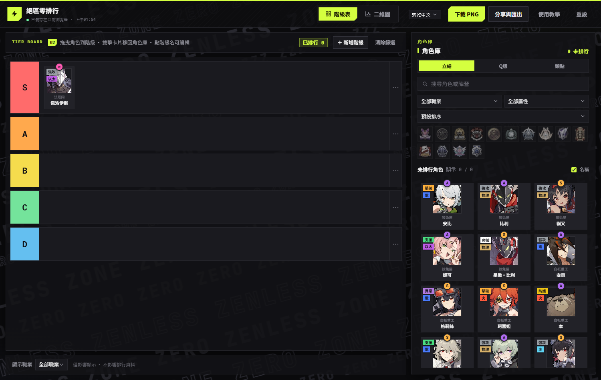

# ゼンゼロ Tier List メーカー

**Zenless Zone Zero ティアリスト × 2軸チャート作成ツール — 純フロントエンド・ビルド不要・完全オフライン**

[繁體中文](../README.md) · [English](README.en.md) · [日本語](README.ja.md) · [한국어](README.ko.md)

---

## 概要

Zenless Zone Zero（ゼンレスゾーンゼロ）向けのコミュニティツール：**ティアリスト**と**強度 × 使いやすさの2軸チャート**を作成できます。純粋な vanilla JavaScript で、ビルドもバックエンドも不要。全アセットがローカルのため、`file://` で直接開いても完全に動作します。

4言語（繁體中文／English／日本語／한국어）に対応。UI文字もキャラ名も即座に切り替わります。

## プレイヤーガイド

**収録内容**

- **63人のエージェント**の職業を収録（強攻／撃破／異常／支援／防護／命破／鋒御）
- 職業・属性・レアリティは検証済み（レアリティはFandomデータと照合）。データの修正は `data.js` へのPRで歓迎します

**操作早見表**

| 操作 | ティアリスト | 2軸チャート |
|---|---|---|
| 配置 | ドラッグで配置／クリックで即配置 | キャラ選択後にボードをクリック／直接ドラッグ |
| 戻す | ダブルクリック／ライブラリへドラッグ | 「チャートから削除」 |
| 微調整 |  | 矢印キー または `W A S D`（`Shift` ＝ 5倍ステップ） |
| 重なり選択 |  | ダブルクリックで循環切替 |
| 重なり順 |  | 「最前面へ」 |
| 画像モード | カード右クリック：立ち絵／ちびキャラ／アバター |  |

**発榜ワークフロー（Discord／Reddit／フォーラム向け）**

1. **プールを絞る** — 14陣営のロゴフィルターや「職業表示」で対象を絞り込む
2. **高速スイープ** — レアリティ／属性順に並べ替え、Sランクから配置してAランクで埋める
3. **2軸プロット** — チャートに切替、強度 × 使いやすさに配置。軸名はカスタム可能（例：「深層攻防／初心者向け」）
4. **エクスポート** — PNGは2倍スケール・暗色背景合成で、そのまま貼り付け可能

## 機能

- **ティアリスト**：ドラッグ／クリックで配置、ダブルクリックでプールへ戻す、ティア名と色の編集、「職業表示」フィルター（表示のみでデータに影響なし）
- **2軸チャート**：クリック／ドラッグで配置、ドットのドラッグ、重なったドットはダブルクリックで循環選択、**矢印キー／WASD での微調整**（Shift で高速）、Y/X 軸名編集、「職業表示」フィルター、PNG エクスポート（canvas 手描き）
- **キャラライブラリ**（右サイドバー共通）：検索（**各言語のキャラ名に対応**）、14陣営ロゴフィルター、職業／属性／並べ替え、「特殊」属性カテゴリ
- **3つの画像モード**：立ち絵／ちびキャラ／アバター（Inter-Knot アイコン）。カード右クリックで個別切替
- **永続化**：localStorage `zzz-tierlist-v2`、旧データは自動移行

## プロジェクト構成

| ファイル | 説明 |
|---|---|
| `index.html` | シェル：ヘッダー ＋ ビュー切替 ＋ main／sidebar |
| `styles.css` | デザインシステム（グラファイトブラック × ネオンライム） |
| `i18n.js` | 4言語辞書 ＋ `data-i18n` バインド ＋ `i18n:change` イベント |
| `app.js` | 状態／フィルター／ドラッグ＆ドロップ／エクスポート／チュートリアル |
| `chart.js` | 2軸チャートモジュール（DOM パーセントドット） |
| `data.js` | 63キャラデータ ＋ `AGENT_NAMES` 多言語名 ＋ 陣営／属性カラーパレット |
| `assets/zzz/` | 立ち絵／ちびキャラ／アバター／ステッカー予備／14陣営ロゴ（全ローカル） |
| `tools/` | アセット取得・自動検証スクリプト（開発用） |

## データモデル（data.js）

- `AGENTS` レコード：`id / name / fullName / faction / role / attribute / specialAttribute / rank / img / imgSquare / imgRound / imgProfile / available`
- `faction` は文字列または**配列**（複数陣営：零号アンビ＝狡兎屋＋オボルス小隊）
- `AGENT_NAMES`：en／ja／ko 表示名マップ（`I18N.agentName()` は zh-TW では `name` を直接使用）
- `FACTIONS`（14）と `ROLE_COLORS`／`ATTRIBUTE_COLORS`／`FACTION_LOGOS`／`FACTION_COLORS` パレット

## コントリビューション

データの修正は `data.js` へ直接 PR。詳細な手順（キャラ追加、i18n の規約、検証）は [CONTRIBUTING.md](../CONTRIBUTING.md) を参照。

## AI 利用記録

コンテンツ制作（データ整理・コード・ドキュメント）は主に AI ツールで作成し、人間が方向付け・テスト・校正を担当：

- **ツール**：pi CLI、opencode2 CLI
- **モデル**：deepseek-v4.1-flash-free、big-pickle、glm-5.3-flash
