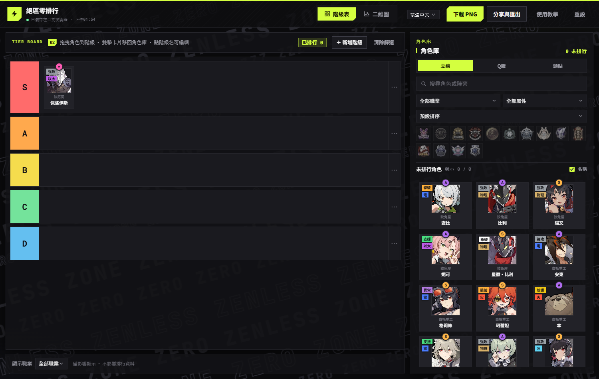
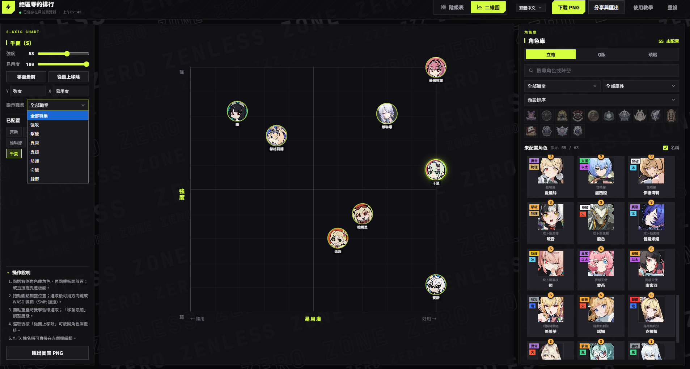

# 젠레스 존 제로 티어 리스트 메이커

**Zenless Zone Zero 티어 리스트 × 2축 차트 제작 도구 — PC·모바일·오프라인에서도 사용 가능**

[繁體中文](../README.md) · [English](README.en.md) · [日本語](README.ja.md) · [한국어](README.ko.md)

---

## 소개

Zenless Zone Zero(젠레스 존 제로) 커뮤니티 도구: **티어 리스트**와 **강력함 × 사용 편의성 2축 차트**를 만들 수 있습니다. 순수 vanilla JavaScript로 빌드도 백엔드도 필요 없으며, 모든 에셋이 로컬에 있어 `file://` 로 직접 열어도 완전히 작동합니다.

4개 언어(繁體中文／English／日本語／한국어)를 지원합니다. UI 문구와 캐릭터 이름 모두 즉시 전환됩니다.

## 플레이어 가이드

**수록 내용**

- **63명의 에이전트** 직업 수록(강공/격파/이상/지원/방어/명파/봉어)
- 직업·속성·희귀도는 전수 검증(희귀도는 Fandom 데이터와 대조). 데이터 정정은 `data.js` 로 PR 환영

**조작 치트시트**

| 동작 | 티어 리스트 | 2축 차트 |
|---|---|---|
| 배치 | 드래그 투입 / 클릭 즉시 배치 | 캐릭터 선택 후 보드 클릭 / 직접 드래그 |
| 복귀 | 더블클릭 / 보관함으로 드래그 | "차트에서 제거" |
| 미세 조정 |  | 방향키 또는 `W A S D`(`Shift` = 5배 이동) |
| 겹침 선택 |  | 더블클릭으로 순환 전환 |
| 순서 변경 |  | "맨 앞으로" |
| 이미지 모드 | 카드 우클릭: 일러스트/치비/아바타 |  |

**발표 워크플로(Discord/Reddit/포럼)**

1. **풀 좁히기** — 14진영 로고 필터 또는 "직업 표시"로 평가 대상만 표시
2. **빠른 스캔** — 희귀도/속성순 정렬, S급 먼저 배치 후 A급 보완
3. **2축 배치** — 차트로 전환, 강력함 × 사용 편의성에 배치. 축 이름 커스텀 가능(예: "심층 공방 / 초보자 추천")
4. **내보내기** — PNG는 2배 스케일·다크 배경 합성으로 바로 게시 가능

## 기능

- **티어 리스트**: 드래그/클릭으로 배치, 더블클릭으로 보관함으로 복귀, 티어 이름·색상 편집, "직업 표시" 필터(표시에만 영향, 데이터 불변)
- **2축 차트**: 클릭/드래그로 배치, 도트 드래그, 겹친 도트는 더블클릭으로 순환 선택, **방향키/WASD 미세 조정**(Shift로 가속), Y/X 축 이름 편집, "직업 표시" 필터, PNG 내보내기(canvas 수동 드로잉)
- **에이전트 보관함**(오른쪽 사이드바 공용): 검색(**각 언어 캐릭터 이름 지원**), 14진영 로고 필터, 직업/속성/정렬, "특수" 속성 분류
- **3가지 이미지 모드**: 일러스트/치비/아바타(Inter-Knot 아이콘). 카드 우클릭으로 개별 전환
- **저장**: localStorage `zzz-tierlist-v2`, 이전 저장본 자동 마이그레이션

## 프로젝트 구조

| 파일 | 설명 |
|---|---|
| `index.html` | 셸: 헤더 + 뷰 탭 + main/sidebar |
| `styles.css` | 디자인 시스템(그래파이트 블랙 × 네온 라임) |
| `i18n.js` | 4개 언어 사전 + `data-i18n` 바인딩 + `i18n:change` 이벤트 |
| `app.js` | 상태/필터/드래그 앤 드롭/내보내기/사용법 |
| `chart.js` | 2축 차트 모듈(DOM 백분율 도트) |
| `data.js` | 63명 캐릭터 데이터 + `AGENT_NAMES` 다국어 이름 + 진영/속성 색상표 |
| `assets/zzz/` | 일러스트/치비/아바타/스티커 예비/14진영 로고(전부 로컬) |
| `tools/` | 에셋 수집 및 자동 검증 스크립트(개발용) |

## 데이터 모델(data.js)

- `AGENTS` 레코드: `id / name / fullName / faction / role / attribute / specialAttribute / rank / img / imgSquare / imgRound / imgProfile / available`
- `faction` 은 문자열 또는 **배열**(복수 진영: 0호 안비 = 교활한 토끼굴 + 오볼 분대)
- `AGENT_NAMES`: en/ja/ko 표시 이름 맵(`I18N.agentName()` 은 zh-TW에서 `name` 을 직접 사용)
- `FACTIONS`(14) 및 `ROLE_COLORS`/`ATTRIBUTE_COLORS`/`FACTION_LOGOS`/`FACTION_COLORS` 색상표

## 기여

데이터 정정은 `data.js` 로 바로 PR. 전체 절차(캐릭터 추가, i18n 규약, 검증)는 [CONTRIBUTING.md](../CONTRIBUTING.md) 참고.

## AI 활용 기록

콘텐츠 제작(데이터 정리·코드·문서)은 주로 AI 도구로 수행했으며, 사람이 방향 설정·테스트·교정을 담당:

- **도구**: pi CLI, opencode2 CLI
- **모델**: deepseek-v4.1-flash-free, big-pickle, glm-5.3-flash
